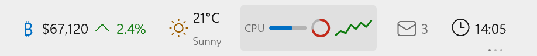
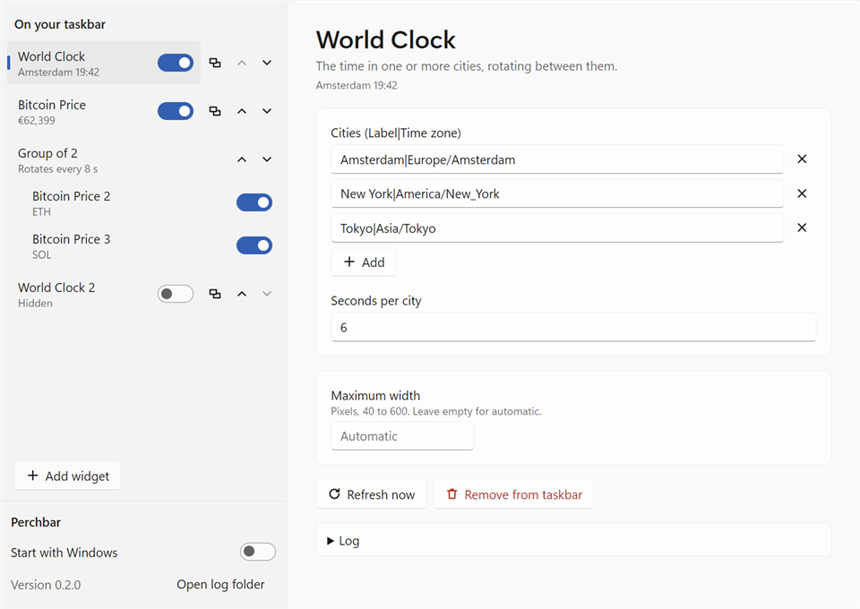

<p align="center">
  
</p>

<h1 align="center">Perchbar</h1>

<p align="center">
  <b>Live widgets on your Windows 11 taskbar. Pick one, tweak it, or build your own.</b>
</p>

<p align="center">
  <a href="https://github.com/bardesss/perchbar/actions/workflows/ci.yml"></a>
  <a href="LICENSE"></a>
  
</p>

<p align="center">
  <picture>
    <source media="(prefers-color-scheme: dark)" srcset="docs/images/strip-dark.png">
    
  </picture>
  <br>
  <sub>Drawn by Perchbar's own renderer. Some of these widgets are still on the way.</sub>
</p>

Windows already puts weather and stock prices on your taskbar. Perchbar lets you decide what goes there instead: the Bitcoin price, the time in Tokyo, your Claude usage, the song that is playing, your headphones' battery. Widgets sit next to the clock and look like they shipped with Windows.

## Why Perchbar

- **Looks native.** System font, light and dark theme, correct scaling at every DPI. No floating window, no frame, no box that doesn't match.
- **Stays out of the way.** Widgets never cover your app buttons. When space runs out, the rest fold into a small "+N" button.
- **Light.** Native rendering instead of a browser engine. Idle CPU is about zero and memory stays well under 100 MB.
- **Survives Explorer.** Explorer restarts, taskbar moves, monitor and DPI changes: the strip reattaches by itself.
- **Safe to try new widgets.** Every widget runs in a sandbox. It can only reach the websites it declares, with time and memory limits, so a broken widget shows an error instead of taking anything down.

## What you can put on it

| Widget | What it shows |
|---|---|
| Bitcoin price | Live price for BTC, ETH, SOL, XRP or DOGE in USD, EUR or GBP, green or red with a small trend line |
| World clock | The time in any number of cities, taking turns in one spot |
| Rotating prices | Several stocks or coins cycling in one spot *(coming soon)* |
| Weather | Current conditions for your location *(coming soon)* |
| Claude limit | How much of your Claude usage window is left *(coming soon)* |
| Now playing | The track playing in Spotify, your browser or any media app *(coming soon)* |
| Device battery | Battery of your Bluetooth headset, mouse or controller *(coming soon)* |

Run the same widget more than once (a clock for each office), or group several widgets so they take turns in one spot.

## Settings

Click a widget to open its settings (a click on a group moves it to the next widget; right-click and choose **Widget settings** instead). **Open Perchbar settings** in the same menu opens the window without a widget picked. From there you add, configure, reorder, group and hide widgets, and turn **Start with Windows** on or off. API keys and other secrets are encrypted for your Windows account and never written to the settings file.

<p align="center">
  <picture>
    <source media="(prefers-color-scheme: dark)" srcset="docs/images/settings-dark.png">
    
  </picture>
</p>

## Make your own

A widget is a folder with two small files. This one shows the time in a city:

```js
export default async function update({ settings, time }) {
  const t = time.now("Asia/Tokyo");
  return {
    blocks: [{ type: "text", value: `Tokyo ${t.hhmm}` }],
    tooltip: `Tokyo · ${t.weekday}`,
  };
}
```

You don't need to be a developer. Point your own AI assistant (ChatGPT, Claude, Copilot or any other) at this repo and describe what you want. The templates in [`widgets/`](widgets) are written as examples for exactly that. Bring your own icon too: drop an SVG or PNG in the widget folder, and Perchbar can tint it to match the taskbar.

To try your widget, open the settings window, choose **Add widget**, then **Load from folder**. Perchbar shows what the widget asks for (the websites it may reach, the files it may read and the sources it uses) and installs it only after you approve. The folder is used where it is, so after an edit you press **Reload** and see the change. If an edit asks for a new website or file, the widget waits until you choose **Allow**. **Remove widget** takes it off Perchbar but never deletes your folder.

A widget folder you copy by hand into Perchbar's `widgets` folder also needs one **Allow** before it can use the network or files. The built-in templates are approved for you.

Made something good? Share it with a pull request, and it can land in the catalog for everyone.

## Status

Perchbar is in early development. The taskbar strip, the sandbox, the settings window and the first two templates work today. Next up:

1. A catalog in this repo, browsable from the app, plus a Share button that turns your widget into a pull request.
2. The remaining templates and a guide for writing widgets with AI.

## Install

Download the latest installer (`Perchbar-x.y.z-setup.exe`) or the portable exe from [Releases](https://github.com/bardesss/perchbar/releases). The installer needs no admin rights. Each release lists SHA-256 checksums in `SHA256SUMS.txt`.

The builds are not code-signed yet, so Windows SmartScreen may say "Windows protected your PC" the first time. Choose **More info**, then **Run anyway**.

## Build from source

You need Windows 11, [Rust](https://rustup.rs) and [Node.js](https://nodejs.org) 22 or newer.

```bash
git clone https://github.com/bardesss/perchbar.git
cd perchbar
npm --prefix ui ci
npm --prefix ui run build
cargo run -p perchbar --release
```

The settings window is built from `ui/` into `ui/dist`, which the Rust build embeds. Run the two npm commands again after changing anything in `ui/`.

On first start you get a Bitcoin price and a world clock, and Perchbar turns on Start with Windows (switch it off in the settings window). Everything Perchbar stores lives in `%APPDATA%\Perchbar`: the widget list in `instances.json`, encrypted secrets in `secrets\` and the log in `perchbar.log`. Set `PERCHBAR_DATA_DIR` to use another folder while you test; such runs never register themselves to start with Windows.

## Security

Widgets are sandboxed: HTTPS only, to the exact hosts listed in their manifest, with limits on time, memory, output size and downloads. Found a hole? Please report it privately; see [SECURITY.md](SECURITY.md).

## License

[MIT](LICENSE)
